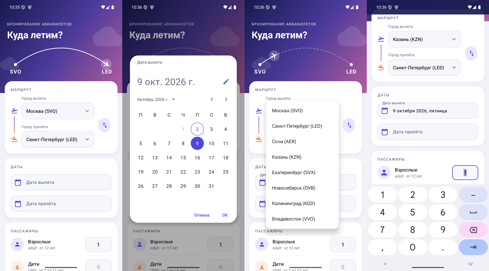

# AviaBooking

Учебное Android-приложение: разметка экрана бронирования авиабилетов. Java, XML-разметка, Material Components.



Видео с проверкой всех пунктов задания: [demo/AviaBooking-demo.mp4](demo/AviaBooking-demo.mp4)

## Что на экране

- **Город вылета и город прилёта** — два `Spinner` с подписями. Список из 8 городов хранится в строковых ресурсах (`string-array name="cities"` в `res/values/strings.xml`) и подключён к спиннерам через `android:entries`. Кнопка между ними меняет города местами.
- **Дата вылета и дата прилёта** — поля с подсказкой. По нажатию открывается календарь `MaterialDatePicker`. Прошедшие даты выбрать нельзя, дата прилёта не может быть раньше даты вылета.
- **Пассажиры** — взрослые (adult, от 12 лет), дети (child, от 2 до 11 лет), младенцы (infant, до 2 лет). У каждого поля есть подпись, `inputType="number"` открывает цифровую клавиатуру.
- **Кнопка «Купить»** — пока без действия.

Анимации: появление карточек по очереди, самолёт летит по маршруту в шапке, коды городов в шапке меняются при выборе, кнопка обмена поворачивается, выбранная дата плавно появляется в поле, кнопка «Купить» сжимается при нажатии.

## Основные файлы

| Файл | Что внутри |
| --- | --- |
| `app/src/main/java/com/example/aviabooking/MainActivity.java` | Выбор дат, обмен городов, анимации экрана |
| `app/src/main/java/com/example/aviabooking/FlightPathView.java` | Шапка с анимированным маршрутом |
| `app/src/main/res/layout/activity_main.xml` | Разметка экрана |
| `app/src/main/res/values/strings.xml` | Тексты и список городов |
| `app/src/main/res/values/styles.xml`, `themes.xml`, `colors.xml` | Оформление |

## Сборка

Нужны JDK 17+ и Android SDK 35. Проект открывается в Android Studio как есть, либо из терминала:

```bash
./gradlew assembleDebug
```

APK появится в `app/build/outputs/apk/debug/`.
